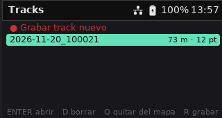
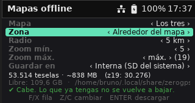

# ZeroGPS

GPS con mapas topográficos del **IGN** para el **M5Stack Cardputer Zero** (Raspberry Pi CM0,
pantalla de 320×170, Linux) con el **Cap LoRa-1262** (LoRa SX1262 + GNSS AT6668). En el
lanzador aparece como **GPS**.

> **Sólo para España.** Los mapas son del **Instituto Geográfico Nacional de España**: fuera
> de España (y de lo que cubre el IGN) no hay mapa. La interfaz está en español.

 

## Mapas

Se elige con la tecla `M` en el mapa (y en la descarga, con la fila «Mapa»):

| Mapa | Qué es | Zoom con detalle | Tesela media |
|---|---|---|---|
| **Topográfico** | MTN, el mapa topográfico nacional: curvas de nivel, caminos, fuentes | hasta 17 | ~20-25 KB |
| **Satélite** | Ortofoto aérea PNOA (25 cm por píxel) | hasta 19 | ~15-17 KB |
| **IGN Base** | Cartografía simplificada, tipo callejero | hasta 18 | ~3-10 KB |

Cada mapa se guarda en su carpeta, así que se pueden tener los tres de la misma zona. Por
encima del zoom con detalle se amplía el último nivel.

## Qué hace

- **Mapa**: tu posición sobre el mapa del IGN (topográfico, satélite o Base), con el track que estás grabando
  (rojo) y el que hayas abierto desde Tracks (morado). Se mueve con las flechas y se centra en
  ti con ENTER. Si falta una tesela a un zoom, amplía la de un zoom menor en vez de dejar un
  hueco.
- **Tracks**: graba tu recorrido en **GPX** (sigue grabando aunque salgas del mapa), lista los
  guardados en `~/Tracks`, los abre en el mapa y los borra.
- **Mapas offline**: descarga una zona entera a la tarjeta para usarla en el monte sin
  cobertura. Eliges el mapa, la zona (alrededor de donde tengas el mapa, con un radio de 1 a 50 km, o
  una zona completa ya hecha: Guadarrama, Gredos, Picos de Europa, Sierra Nevada, Pirineo
  central, Cazorla, Montseny, Madrid), el **zoom mínimo y máximo** y **dónde guardarla** (la
  tarjeta del sistema o una tarjeta/pincho montado). Antes de bajar nada ves **cuántas
  teselas son, cuánto ocuparán y cuánto espacio libre hay**: avisa si va justo y no deja
  empezar si no cabe. Lo que ya tengas no se vuelve a bajar, así que una descarga cortada se
  retoma repitiéndola.
- **Modo online** (tecla `O` en el mapa): con wifi, baja sólo las teselas que faltan en
  pantalla. Viene apagado.

Trae de serie las teselas de la Sierra de Guadarrama (zooms 12 a 14) para tener mapa sin
descargar nada.

 

## Batería

La batería del Cardputer Zero es pequeña, así que la app intenta gastar lo mínimo:

- El GNSS (y los 5V del cap) **sólo está encendido** con el mapa abierto o mientras grabas.
- El mapa se refresca **según el zoom**: cada segundo de cerca (z16-18), cada 2 s a z14-15,
  cada 5 s a z12-13 y cada 10 s más lejos. Y sólo se repinta si te has movido al menos 2
  píxeles: de lejos, aunque andes, el punto casi no se mueve.
- El hilo del GNSS duerme hasta que llegan datos; el track guarda un punto cada 5 m (o cada
  30 s si vas muy despacio) y el GPX se escribe en la tarjeta una vez por minuto.
- Nada de wifi salvo que tú lo pidas (descarga de zona o modo online).

## Teclas

| Dónde | Tecla | Qué hace |
|---|---|---|
| Todas | `Fn`+`H` | Ayuda |
| | `Fn`+`J` | Captura de pantalla |
| | `T` | Claro / oscuro |
| | `Esc` / mantener `Esc` | Atrás / salir |
| Mapa | Flechas (`F` `Z` `X` `C`, con o sin `Fn`) | Mover el mapa |
| | `ENTER` | Centrar en mi posición |
| | `+` `-` (o `.` `,`) | Zoom |
| | `R` | Grabar / parar track |
| | `M` | Cambiar de mapa: topográfico, satélite, IGN Base |
| | `O` | Modo online |
| | `D` | Descargar la zona que estás viendo |
| Tracks | `ENTER` | Grabar / parar, o abrir el track en el mapa |
| | `D` (dos veces) | Borrar el track |
| | `Q` | Quitar del mapa el track abierto |
| Mapas offline | `F`/`X` · `Z`/`C` · `ENTER` | Elegir fila · cambiar valor · descargar |

## Dónde guarda las cosas

- Tracks: `~/Tracks/AAAA-MM-DD_hhmmss.gpx` (hora UTC del GPS).
- Teselas: `~/.local/share/zerogps/tiles/` (o `<tarjeta>/ZeroGPS/tiles/` si eliges otra
  tarjeta): el topográfico en `z/x/y.jpeg`, el satélite en `pnoa/z/x/y.jpeg` y el Base en
  `base/z/x/y.jpeg`. El mapa busca en todas las tarjetas.
- Ajustes de mapas: `~/.config/zerogps/maps.conf`.

## Compilar

```sh
Tools/compilar.sh pruebas     # simulador de escritorio (SDL2) y pruebas
Tools/compilar.sh deb         # dist/ZeroGPS_<versión>_rev1_arm64.deb para el aparato
Tools/compilar.sh simulador   # abre el simulador en este escritorio (X11)
```

La primera vez descarga LVGL 9.5 y el *sysroot* de M5Stack a `.cache/` (no se versiona). En el
simulador el GNSS es simulado (un paseo por el puerto de Navacerrada); en el aparato,
`ZEROGPS_GNSS=sim` hace lo mismo. Las descargas usan el `curl` del sistema (dependencia del
paquete).

## Mapas y licencia

Las teselas vienen de los servicios WMTS del IGN, con el conjunto `GoogleMapsCompatible`:
`mapa-raster` (capa `MTN`), `pnoa-ma` (capa `OI.OrthoimageCoverage`) e `ign-base` (capa
`IGNBaseTodo`). Los datos son **© Instituto Geográfico Nacional de España** (la ortofoto, del
PNOA), con licencia **CC-BY 4.0**: la atribución se ve siempre en el mapa. La app pide las
teselas con moderación (como mucho 3 a la vez) y pone un tope de 100.000 teselas por descarga:
es para llevarte tus zonas, no para volcar el servicio.

El código es MIT (ver `LICENSE`). Las teselas incluidas en `assets/tiles` son datos del IGN
bajo CC-BY 4.0.

## Estado

**0.3.0**: tres mapas del IGN (topográfico, satélite y Base), grabación de tracks, mapas
offline y modo online. Probado en el simulador; **sin probar en el aparato** (falta comprobar el GNSS real por `/dev/serial0`). El
LoRa (SX1262) queda para más adelante.
